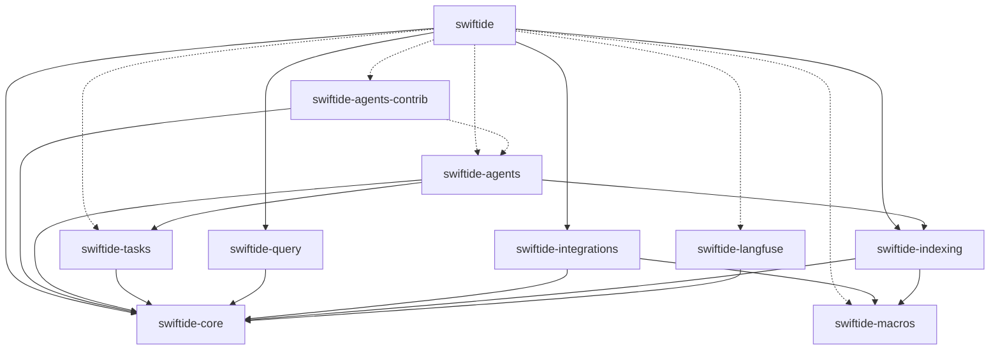

# Architecture

Swiftide is a Rust workspace for building retrieval-augmented generation (RAG) pipelines and LLM agents. It is split into a core crate of shared traits, building-block crates for indexing, querying, tasks and agents, an integrations crate with concrete backends, and a `swiftide` facade crate that re-exports everything behind feature flags.

## Bird's-eye view

**Foundation.** `swiftide-core` defines the traits and types everything else builds on: `Node`, `Loader`, `Transformer`, `Persist`, `EmbeddingModel`, `ChatCompletion`, `Tool`, `AgentContext` and the typestate `Query`. It has no provider-specific logic and depends on no workspace crate. `swiftide-macros` is a separate proc-macro crate with no workspace dependencies. It generates boilerplate for transformers and tools.

**Building blocks.** `swiftide-indexing` provides the streaming indexing `Pipeline`. `swiftide-query` provides the query `Pipeline`. `swiftide-tasks` provides a typed task-graph engine. `swiftide-agents` provides the agent runtime and uses `swiftide-indexing` (for `FileLoader`) and `swiftide-tasks` (for `TaskAgent`). `swiftide-agents-contrib` adds optional tools and hooks, and `swiftide-langfuse` adds a Langfuse tracing layer.

**Integrations and facade.** `swiftide-integrations` implements the core traits for external services: LLM providers, vector stores, key-value stores, queues and loaders. Each integration is feature-gated. Users normally depend only on `swiftide` and turn on the features they need. Crates that implement or extend a single trait can depend directly on `swiftide-core`.

## Crate map

| Crate | Responsibility | Start reading at |
| --- | --- | --- |
| `swiftide-core` | Shared traits, types and errors for indexing, querying, chat completion, tools and agent abstractions. | `Node`, `Transformer`, `ChatCompletion` |
| `swiftide-langfuse` | `tracing` layer that sends spans and events carrying `langfuse.*` fields to Langfuse as traces and observations, batched in the background. | `LangfuseLayer`, `LangfuseBatchManager` |
| `swiftide-macros` | Proc macros: `#[indexing_transformer]`, `#[tool]` and `#[derive(Tool)]`. | `indexing_transformer`, `tool`, `Tool` |
| `swiftide-indexing` | Streaming indexing `Pipeline` plus built-in loaders, chunkers, embedding and metadata transformers, and in-memory storage. | `Pipeline`, `FileLoader`, `Embed` |
| `swiftide-integrations` | Feature-gated implementations of core traits for LLM providers, embedding models, stores, queues, loaders and tree-sitter transformers. | `OpenAI`, `Qdrant`, `Redis` |
| `swiftide-query` | Lazy, streaming query `Pipeline` with ready-made transformers, an answer step and a RAGAS evaluator. | `Pipeline`, `answers::Simple`, `evaluators::ragas::Ragas` |
| `swiftide-tasks` | Typed task graph with compile-time-checked transitions, fan-out and joins, pause and resume. | `Task`, `TaskNode`, `Transition` |
| `swiftide-agents` | Agent runtime: completion and tool-call loop, builder, hooks, default context and local executor, control tools, optional MCP toolbox. | `Agent`, `AgentBuilder`, `DefaultContext` |
| `swiftide-agents-contrib` | Opt-in file and planning tools, LLM-backed context-management hooks, and a lazy executor wrapper. | `ReadFile`, `ContextCompression`, `LazyExecutor` |
| `swiftide` | Facade crate that re-exports the other crates under one namespace and maps Cargo features onto theirs. | `indexing`, `query`, `integrations` |

## Dependency graph

- **Core changes ripple widely.** A change to a trait or type in `swiftide-core` affects every other crate except `swiftide-macros`. New shared abstractions belong in `swiftide-core`.
- **New backends go in `swiftide-integrations`.** It depends only on `swiftide-core` and `swiftide-macros`, so a new provider or store does not touch the pipeline crates. Add a matching feature flag in `swiftide` as well.
- **Pipeline and runtime logic is isolated.** Changes to `swiftide-indexing`, `swiftide-query` and `swiftide-tasks` stay in their own crates, and `swiftide` only re-exports them. The exception is `swiftide-indexing`, which `swiftide-agents` also uses (via `LocalExecutor`), and `swiftide-tasks`, which `swiftide-agents` uses for `TaskAgent`.
- **Macro changes affect both users and generated code.** `swiftide-indexing` and `swiftide-integrations` use `#[indexing_transformer]`. Generated `Tool` code points at `::swiftide::...` paths, so it needs the `swiftide` facade at the use site.
- **The agent layer is a dependency chain.** `swiftide-agents-contrib` depends optionally on `swiftide-agents`, so changes to agent hook types or `LocalExecutor` can break it. `swiftide-langfuse` depends only on `swiftide-core` (for `Usage`) and can change independently.

## Data flow

### Index documents into a store

1. A `Loader` produces an `IndexingStream` of `Node`s. `FileLoader` (`swiftide-indexing`) walks the filesystem. `Kafka`, `Fluvio`, `Parquet` and `ScrapingLoader` (`swiftide-integrations`) are alternatives.
2. `Pipeline::from_loader` (`swiftide-indexing`) starts the pipeline.
3. `then_chunk` runs a `ChunkerTransformer` such as `ChunkText` or `ChunkMarkdown`. Code chunkers like `ChunkCode` come from `swiftide-integrations`.
4. `then` runs LLM metadata transformers such as `MetadataQAText`. They call a `SimplePrompt` model, set with `with_default_llm_client`.
5. `then_in_batch` runs `Embed` or `SparseEmbed`, which use an `EmbeddingModel` or `SparseEmbeddingModel` such as `FastEmbed` or `OpenAI`.
6. `then_store_with` writes nodes to a `Persist` implementation such as `Qdrant`, `PgVector`, `LanceDB`, `Redis` or `MemoryStorage`.
7. `run` drives the stream to completion.

### Answer a question over indexed data

1. Build a `Pipeline` (`swiftide-query`) for a `SearchStrategy` such as `SimilaritySingleEmbedding`. The `Query` starts as `Pending`.
2. `then_transform_query` runs a `TransformQuery` step: `query_transformers::Embed`, `SparseEmbed` or `GenerateSubquestions`.
3. `then_retrieve` runs a `Retrieve` implementation for that strategy, for example a store from `swiftide-integrations` such as `Qdrant`. The query becomes `Retrieved`.
4. `then_transform_response` optionally runs a `TransformResponse` step such as `response_transformers::Summary`.
5. `then_answer` runs an `Answer` step such as `answers::Simple`, which prompts a `SimplePrompt` LLM. The query becomes `Answered`.
6. Optionally, `evaluate_with` records the run in `Ragas` (an `EvaluateQuery`).
7. `query`, `query_mut` or `query_all` runs the pipeline.

### Run an agent

1. Build the agent with `Agent::builder()` (`swiftide-agents`). Set an LLM (a `ChatCompletion` such as `OpenAI` or `Anthropic` from `swiftide-integrations`), tools, and hooks such as `before_completion` or `after_tool`.
2. Tools come from `#[tool]` or `#[derive(Tool)]` (`swiftide-macros`), from built-in control tools such as `Stop`, from `swiftide-agents-contrib` (`ReadFile`, `ApplyPatch`) or from an `McpToolbox`.
3. The agent uses `DefaultContext` unless you supply another `AgentContext`. `DefaultContext` keeps the `MessageHistory` and runs commands through a `ToolExecutor`, `LocalExecutor` by default.
4. The agent loops: it requests a completion, runs the returned `ToolCall`s via the context, and appends the `ToolOutput`s to the history.
5. The loop ends when a stop tool runs or an error occurs. `State` and `StopReason` record why it stopped.
6. To orchestrate agents, wrap one in `TaskAgent` and register it in a `Task` (`swiftide-tasks`). It takes a `Prompt` as input and returns `()`.

## Extension points

- To add a data source, implement `Loader` (`swiftide-core`).
- To add a per-node indexing step, implement `Transformer` (`swiftide-core`).
- To add a batched indexing step, implement `BatchableTransformer` (`swiftide-core`).
- To add a chunking step, implement `ChunkerTransformer` (`swiftide-core`).
- To add an LLM-prompting indexing transformer, use `#[indexing_transformer]` (`swiftide-macros`).
- To add a storage backend, implement `Persist` (`swiftide-core`).
- To add a node cache, implement `NodeCache` (`swiftide-core`).
- To add an LLM provider, implement `SimplePrompt`, `StructuredPrompt` or `ChatCompletion` (`swiftide-core`).
- To add an embedding model, implement `EmbeddingModel` or `SparseEmbeddingModel` (`swiftide-core`).
- To add a query step, implement `TransformQuery`, `TransformResponse`, `Answer` or `EvaluateQuery` (`swiftide-core`).
- To add a retrieval backend, implement `Retrieve<S: SearchStrategy>` (`swiftide-core`).
- To add an agent tool, implement `Tool` (`swiftide-core`), or use `#[tool]` on an async fn or `#[derive(Tool)]` on a struct (`swiftide-macros`).
- To expose a set of tools dynamically, implement `ToolBox` (`swiftide-core`).
- To change how an agent stores messages or runs tools, implement `AgentContext`, `MessageHistory` or `ToolExecutor` (`swiftide-core`).
- To hook into the agent lifecycle, pass closures to `AgentBuilder` methods such as `before_tool` or `after_each` (`swiftide-agents`).
- To add helpers to a custom executor, implement `ToolExecutorExt` (`swiftide-agents-contrib`).
- To add a step to a task graph, implement `TaskNode` (`swiftide-tasks`).

## Cross-cutting concerns

- **Feature flags in `swiftide`.** The facade's default feature is `macros`. Most provider and storage flags forward to the same-named feature in `swiftide-integrations`. `swiftide-agents` implies `swiftide-tasks`. The `agents-contrib-*` flags enable individual contrib capabilities.
- **Feature flags in `swiftide-integrations`.** Each integration module is compiled only when its same-named feature is enabled.
- **Feature flags in other crates.** `swiftide-agents` has `mcp` (for `McpToolbox`), `json-schema` and `langfuse`. In `swiftide-agents-contrib` every capability (`context-management`, `file-tools`, `planning`, `lazy-executor`) is off by default and never registers itself on an agent. `swiftide-core` has `metrics`, `test-utils`, `truncate-debug`, `openai` and `qdrant`; its default feature is spelled `defaults`, so it is not the default set. `swiftide-indexing` has only an empty `tree-sitter` flag.
- **Langfuse observability.** Add `LangfuseLayer` (`swiftide-langfuse`) to a `tracing` subscriber. It reads spans and events with `langfuse.*` fields, including `langfuse.usage` built from `Usage` (`swiftide-core`). The `langfuse` feature of `swiftide-agents` adds `langfuse.input` and `langfuse.output` fields. These are emitted at `debug` level, so the subscriber needs a DEBUG filter.
- **Langfuse credentials and delivery.** `LangfuseLayer::default()` reads `LANGFUSE_PUBLIC_KEY`, `LANGFUSE_SECRET_KEY` and optionally `LANGFUSE_URL`, and panics if the keys are missing. `LangfuseBatchManager` sends batches every 5 seconds, retries 429/5xx responses up to 3 attempts, and flushes on drop.
- **Error handling.** Error types are specific to each layer: `LanguageModelError` and `CommandError` (`swiftide-core`), `AgentError` and `AgentBuilderError` (`swiftide-agents`), and `NodeError` and `TaskError` (`swiftide-tasks`). `tool_derive_impl` (`swiftide-macros`) returns a `syn::Result`, so macro errors become compile errors.
- **Test utilities.** The `test-utils` feature of `swiftide-core` enables mockall-based mocks such as `MockChatCompletion`. `swiftide-indexing` tests use `MockSimplePrompt`. `swiftide-agents` has `MockTool` and `MockHook` in `test_utils`, compiled for tests or debug builds. `swiftide-macros` is checked with insta snapshots and trybuild compile-fail tests, and `swiftide-tasks` checks graph wiring with trybuild UI tests.
