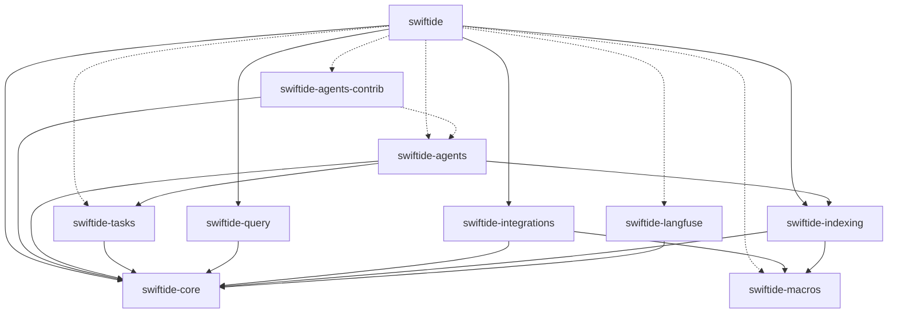

# Example output

Real runs on the Swiftide repository (10 publishable crates), from a debug build started with
`cargo run`, exactly as in the README. Nothing below is edited except where `...` marks trimmed
lines.

- **Endpoint:** an OpenAI-compatible gateway on `http://127.0.0.1:8080/v1` (Bifrost in front of
  AWS Bedrock), reached through `OPENAI_BASE_URL`. The key is the gateway's virtual key.
- **Model:** `claude-sonnet-5-5` for all ten crate analysts and for the document writer, called
  through Chat Completions (the default; `--responses-api` was off).
- **Environment:** the user's global cargo config sets `RUST_LOG=swiftide=debug`, which
  `cargo run` passes on. The CLI ignores `RUST_LOG` and sends any tracing to stderr, so stderr
  stayed empty in both runs and stdout holds only what is shown here.

```console
$ export OPENAI_BASE_URL=http://127.0.0.1:8080/v1
$ export OPENAI_API_KEY=<gateway virtual key>
$ export OPENAI_MODEL=claude-sonnet-5-5
```

## Approved run

Run from the repository root, answering `y` at the approval prompt. To keep the repository clean
the document went to `target/ARCHITECTURE.md`. The file is byte-for-byte the draft shown at the
prompt, so the block below is the complete generated document.

````console
$ echo y | cargo run -q -p workspace-architect -- --output target/ARCHITECTURE.md
[   0.0s] model    claude-sonnet-5-5 via Chat Completions at http://127.0.0.1:8080/v1
[   0.0s] discover 10 crates (7 other members skipped) in /Users/timonv/projects/swiftide-wt-docs-showcases
[   0.0s] analyse  started  swiftide-core
[   0.0s] analyse  started  swiftide-langfuse
[   0.0s] analyse  started  swiftide-macros
[   0.0s] analyse  started  swiftide-indexing
[   0.0s] analyse  started  swiftide-integrations
[   0.0s] analyse  started  swiftide-query
[   0.0s] analyse  started  swiftide-tasks
[   0.0s] analyse  started  swiftide-agents
[   0.0s] analyse  started  swiftide-agents-contrib
[   0.0s] analyse  started  swiftide
[  14.0s] analyse  finished swiftide-langfuse in 14.0s (6 tool calls)
[  14.3s] analyse  finished swiftide-macros in 14.3s (6 tool calls)
[  14.7s] analyse  finished swiftide in 14.7s (5 tool calls)
[  19.2s] analyse  finished swiftide-query in 19.1s (10 tool calls)
[  19.7s] analyse  retry    swiftide-agents-contrib: the `stop` arguments do not match the schema: unknown field `arguments`, expected one of `purpose`, `key_types`, `depends_on`, `notes`
[  20.2s] analyse  finished swiftide-agents in 20.2s (10 tool calls)
[  24.4s] analyse  finished swiftide-indexing in 24.4s (10 tool calls)
[  24.9s] analyse  finished swiftide-tasks in 24.9s (10 tool calls)
[  27.1s] analyse  finished swiftide-agents-contrib in 27.1s (11 tool calls)
[  31.4s] analyse  finished swiftide-integrations in 31.4s (13 tool calls)
[  33.9s] analyse  retry    swiftide-core: the `stop` arguments do not match the schema: unknown field `arguments`, expected one of `purpose`, `key_types`, `depends_on`, `notes`
[  40.5s] analyse  finished swiftide-core in 40.5s (15 tool calls)
[  40.5s] join     10 summaries; 230s of agent work in 41s wall-clock (5.7x)
[  40.5s] render   drafting ARCHITECTURE.md
[  68.8s] review   draft ready (11210 bytes), waiting for approval

────────────────────────────────────────────────────────────────────────────────
# Architecture

Swiftide is a Rust workspace for building LLM applications: streaming RAG indexing, RAG query pipelines, tool-using agents and typed task graphs. `swiftide-core` holds the shared traits and types. Separate crates implement the pipelines, integrations, agents and tasks on top of it. The `swiftide` crate is a facade that re-exports them.

## Bird's-eye view

The foundation is `swiftide-core`. It defines traits and data types (`Node`, `Loader`, `Transformer`, `Persist`, `Query`, `ChatCompletion`, `Tool`, `AgentContext`, `ToolExecutor`) and has no workspace dependencies. `swiftide-macros` is a second leaf crate. It is a proc-macro crate that generates transformer and tool boilerplate.

The building blocks sit on top of core. `swiftide-indexing` and `swiftide-query` provide the indexing and query pipelines. `swiftide-tasks` provides typed task graphs. `swiftide-agents` provides the agent loop. `swiftide-agents-contrib` adds optional agent tools and hooks. `swiftide-langfuse` is a tracing layer that depends only on core. `swiftide-integrations` implements the core traits for external services (LLM providers, vector stores, queues, tree-sitter), and each integration is gated by a Cargo feature.

Users normally depend on `swiftide` alone and enable features to pull in the parts they need. The facade re-exports all of the crates above, some behind optional features.

## Crate map

| Crate | Responsibility | Start reading at |
|---|---|---|
| `swiftide-core` | Shared traits, data types and errors for indexing, querying, chat completion, tools and agent context. No integrations. | `Node`, `Query`, `ChatCompletion` |
| `swiftide-langfuse` | `tracing_subscriber` layer that batches `langfuse.*` spans and events and sends them to the Langfuse ingestion API. | `LangfuseLayer`, `LangfuseBatchManager` |
| `swiftide-macros` | Proc macros: `#[indexing_transformer]`, `#[tool]` and `#[derive(Tool)]`. | `indexing_transformer`, `tool` |
| `swiftide-indexing` | Streaming indexing pipeline with a file loader, text, markdown and metadata transformers, and in-memory storage. | `Pipeline`, `FileLoader`, `Embed` |
| `swiftide-integrations` | Feature-gated implementations of core traits for LLM providers, embeddings, stores, caches, queues, loaders and tree-sitter code processing. | `GenericOpenAI`, `Qdrant`, `FastEmbed` |
| `swiftide-query` | Typed, lazy query pipeline with ready-made query transformers, a response transformer, an answerer and a RAGAS evaluator. | `Pipeline`, `answers::Simple`, `evaluators::ragas::Ragas` |
| `swiftide-tasks` | In-process typed task graph engine with transitions, fan-out/join, pause and resume, and adapters for closures and core traits. | `Task`, `TaskNode`, `Transition` |
| `swiftide-agents` | LLM agent loop over chat completions and tool calls, with hooks, a default context, a local executor and optional MCP toolboxes. | `Agent`, `AgentBuilder`, `DefaultContext` |
| `swiftide-agents-contrib` | Opt-in agent extras: planning and file tools, context-management hooks and a lazy executor wrapper. | `UpdatePlan`, `ContextCompression`, `LazyExecutor` |
| `swiftide` | Facade crate that re-exports the workspace crates under one namespace, with features that forward to them. | `indexing`, `query`, `agents` |

## Dependency graph



- A change to a trait or type in `swiftide-core` ripples into every other crate except `swiftide-macros`. Treat core as the stable contract.
- Add a new external service in `swiftide-integrations`. Nothing else in the graph needs to change, because pipelines and agents consume core traits.
- `swiftide-indexing` and `swiftide-query` do not depend on each other or on `swiftide-integrations`. Backends are plugged in by the caller, usually through the `swiftide` facade.
- `swiftide-agents` depends on `swiftide-indexing` (its `LocalExecutor` uses `FileLoader`) and on `swiftide-tasks` (for `TaskAgent`). Changes in those crates can affect agents. `swiftide-agents-contrib` builds on `swiftide-agents` only through optional features.
- Macro output is used by `swiftide-indexing` and `swiftide-integrations`. Generated tool code refers to `::swiftide::...` paths, so changes to facade re-exports can break `#[tool]` users even though `swiftide-macros` has no build dependency on `swiftide`.

## Data flow

### Indexing documents into a store

1. Create a `Pipeline` (`swiftide-indexing`) with `from_loader`, using a `Loader` such as `FileLoader` (`swiftide-indexing`) or `Parquet` (`swiftide-integrations`).
2. The loader yields an `IndexingStream` of `Node`s (`swiftide-core`).
3. Chunk the nodes with `then_chunk`, using `ChunkText` or `ChunkMarkdown` (`swiftide-indexing`), or `ChunkCode` (`swiftide-integrations`).
4. Add metadata with `then`, using transformers such as `MetadataTitle` (`swiftide-indexing`). These prompt an LLM through `SimplePrompt`, for example `OpenAI` (`swiftide-integrations`).
5. Embed the chunks with `then_in_batch`, using `Embed` or `SparseEmbed` (`swiftide-indexing`) with an `EmbeddingModel` or `SparseEmbeddingModel`.
6. Persist with `then_store_with`, using a `Persist` implementation such as `Qdrant` or `PgVector` (`swiftide-integrations`) or `MemoryStorage` (`swiftide-indexing`).
7. Call `run` to execute the pipeline.

### Answering a query with RAG

1. Build a `Pipeline` (`swiftide-query`) in the `Pending` state.
2. Transform the query with `then_transform_query`, using `query_transformers::GenerateSubquestions` or `query_transformers::Embed`.
3. Retrieve documents with `then_retrieve`, using a `Retrieve` implementation such as `Qdrant` (`swiftide-integrations`) and a strategy like `SimilaritySingleEmbedding` or `HybridSearch`. The `Query` becomes `Retrieved`.
4. Optionally transform the response with `then_transform_response`, for example `response_transformers::Summary`.
5. Generate the answer with `then_answer`, using `answers::Simple`. The `Query` becomes `Answered`.
6. Run the pipeline with `query`, `query_mut` or `query_all`. Optionally call `evaluate_with` to record results in `evaluators::ragas::Ragas`.

### Running an agent

1. Build an `Agent` with `Agent::builder()` (`AgentBuilder`, `swiftide-agents`). Set the `llm` (a `ChatCompletion`), add tools with `add_tool` or `add_toolbox`, and register hooks.
2. Tools come from `#[tool]` or `#[derive(Tool)]` (`swiftide-macros`), from `McpToolbox` (`swiftide-agents`, feature `mcp`), or from `swiftide-agents-contrib`.
3. Call `query` or `run`. `Agent` stores the prompt in the `AgentContext`, by default `DefaultContext`.
4. The loop sends the history and `ToolSpec`s to the LLM through `ChatCompletion`, and runs hooks around each step.
5. For each `ToolCall`, the context executes the tool through a `ToolExecutor`, by default `LocalExecutor`. The `ToolOutput` is added to the history.
6. The loop repeats until a stop condition is reached. `State` and `StopReason` record why it stopped.

## Extension points

- To add a data source, implement `Loader` (`swiftide-core`).
- To add an indexing step, implement `Transformer`, `BatchableTransformer` or `ChunkerTransformer` (`swiftide-core`). Closures also work for `Transformer` and `BatchableTransformer`.
- To add a prompt-driven indexing transformer, use `#[indexing_transformer]` (`swiftide-macros`).
- To add a storage backend, implement `Persist` (`swiftide-core`).
- To add a node cache, implement `NodeCache` (`swiftide-core`).
- To add an LLM or embedding provider, implement `SimplePrompt`, `StructuredPrompt`, `ChatCompletion`, `EmbeddingModel` or `SparseEmbeddingModel` (`swiftide-core`).
- To add a retrieval backend, implement `Retrieve` (`swiftide-core`) for the search strategy you support.
- To add a query step, implement `TransformQuery`, `TransformResponse`, `Answer` or `EvaluateQuery` (`swiftide-core`).
- To add an agent tool, implement `Tool` (`swiftide-core`), or use `#[tool]` or `#[derive(Tool)]` (`swiftide-macros`).
- To add a group of tools, such as an external server's tools, implement `ToolBox` (`swiftide-core`).
- To change how an agent stores history or runs tools, implement `AgentContext` (`swiftide-core`). To store history elsewhere, implement `MessageHistory` (`swiftide-core`).
- To run agent commands in another environment, implement `ToolExecutor` (`swiftide-core`). To add lazy start, cleanup and download for it, implement `ToolExecutorExt` (`swiftide-agents-contrib`).
- To add a step to a task graph, implement `TaskNode` (`swiftide-tasks`).
- To react to agent lifecycle events, register hook closures such as `BeforeToolFn` or `AfterCompletionFn` (`swiftide-agents`).

## Cross-cutting concerns

- **Feature flags:** `swiftide-integrations` gates each integration behind a feature of the same name. Nearly all `swiftide` features forward to `swiftide-integrations`, `swiftide-core` or `swiftide-agents`. Only `macros` is on by default. `swiftide-agents-contrib` has `context-management`, `planning`, `file-tools` and `lazy-executor`, all off by default. `swiftide-agents` has `mcp`, `json-schema` and `langfuse`.
- **Core feature flags:** `swiftide-core` has `test-utils`, `metrics`, `qdrant`, `openai`, `json-schema` and `truncate-debug`.
- **Observability:** Agents and completion traits emit `debug`-level tracing spans. Register `LangfuseLayer` (`swiftide-langfuse`) to send them to Langfuse. It reads `LANGFUSE_PUBLIC_KEY`, `LANGFUSE_SECRET_KEY` and `LANGFUSE_URL`. `LangfuseBatchManager` sends events every 5 seconds and retries on 429 and 5xx responses.
- **Metrics:** The `metrics` feature of `swiftide-core` enables its `metrics` module.
- **Error handling:** `swiftide-core` defines `LanguageModelError`, `ToolError` and `CommandError`. `swiftide-tasks` defines `NodeError` and `TaskError` and reuses the core errors in its adapters.
- **Test utilities:** The `test-utils` feature of `swiftide-core` adds mockall mocks such as `MockChatCompletion` and `MockSimplePrompt`. `swiftide-macros` is tested with insta snapshots and trybuild compile-fail tests. `swiftide-tasks` uses trybuild UI tests to enforce graph typing.
────────────────────────────────────────────────────────────────────────────────

Write this ARCHITECTURE.md? [y/N] 
[  68.8s] review   draft approved
[  68.8s] write    /Users/timonv/projects/swiftide-wt-docs-showcases/target/ARCHITECTURE.md (11210 bytes)
Wrote /Users/timonv/projects/swiftide-wt-docs-showcases/target/ARCHITECTURE.md (11210 bytes) in 68.8s.
````

### The parallel fan-out

All ten analysts start at the same moment, because `ConcurrencyModel::Parallel` runs every
fan-out branch at once:

| | Approved run | Verbose run (below) |
| --- | --- | --- |
| Fastest analyst | `swiftide-langfuse`, 14.0s | `swiftide-langfuse`, 13.2s |
| Slowest analyst | `swiftide-core`, 40.5s (one retry) | `swiftide-integrations`, 33.3s (one retry) |
| Agent time, summed over all branches | 230s | 217s |
| Wall-clock time for the fan-out | 41s | 33s |
| Speed-up from running in parallel | 5.7x | 6.5x |
| Writing the document (`render`) | 28.3s | 28.1s |

The fan-out takes as long as its slowest branch. Run one after another, the ten analyses would
take close to four minutes before the writer could start.

### The `retry` lines

Some agents call `stop` with their report nested under an `arguments` key. `CrateReport`
rejects unknown fields, so serde names the mistake (``unknown field `arguments` ``) and the
analyst sends that error back with a request to call `stop` again with top-level fields. Every
agent corrected itself on the first retry. The retry costs time: in the approved run it made
`swiftide-core` the slowest branch. It happened in two of ten branches in the approved run and in
one of ten in the verbose run, where the `tool` line shows the nested call.

## Tool calls with `--verbose`, draft declined

A second run with the same build and model, started at the same time as the approved run. It
shows how the branches interleave and the report each agent hands back. The draft was declined
with `n`, so nothing was written.

```console
$ echo n | cargo run -q -p workspace-architect -- --verbose
[   0.0s] model    claude-sonnet-5-5 via Chat Completions at http://127.0.0.1:8080/v1
[   0.0s] discover 10 crates (7 other members skipped) in /Users/timonv/projects/swiftide-wt-docs-showcases
[   0.0s] analyse  started  swiftide-core
[   0.0s] analyse  started  swiftide-langfuse
[   0.0s] analyse  started  swiftide-macros
[   0.0s] analyse  started  swiftide-indexing
[   0.0s] analyse  started  swiftide-integrations
[   0.0s] analyse  started  swiftide-query
[   0.0s] analyse  started  swiftide-tasks
[   0.0s] analyse  started  swiftide-agents
[   0.0s] analyse  started  swiftide-agents-contrib
[   0.0s] analyse  started  swiftide
[   1.8s] tool     swiftide-langfuse: list_files({"dir":"."})
[   1.8s] tool     swiftide-langfuse: read_file({"path":"Cargo.toml","start_line":null})
[   1.8s] tool     swiftide-core: list_files({"dir":"."})
[   1.8s] tool     swiftide-core: read_file({"path":"src/lib.rs","start_line":null})
[   2.1s] tool     swiftide-indexing: list_files({"dir":"."})
[   2.1s] tool     swiftide-indexing: read_file({"path":"Cargo.toml","start_line":null})
[   2.1s] tool     swiftide-indexing: read_file({"path":"src/lib.rs","start_line":null})
[   2.2s] tool     swiftide-tasks: list_files({"dir":"."})
[   2.2s] tool     swiftide-tasks: read_file({"path":"src/lib.rs","start_line":null})
[   2.3s] tool     swiftide-agents: list_files({"dir":"."})
[   2.3s] tool     swiftide-agents: read_file({"path":"Cargo.toml","start_line":null})
[   2.3s] tool     swiftide-agents: read_file({"path":"src/lib.rs","start_line":null})
[   2.6s] tool     swiftide-query: list_files({"dir":"."})
[   2.6s] tool     swiftide-query: read_file({"path":"src/lib.rs","start_line":null})
[   3.0s] tool     swiftide-agents-contrib: list_files({"dir":"."})
[   3.0s] tool     swiftide-agents-contrib: read_file({"path":"Cargo.toml","start_line":null})
[   3.3s] tool     swiftide-macros: list_files({"dir":"."})
[   3.3s] tool     swiftide-macros: read_file({"path":"Cargo.toml","start_line":null})
[   3.3s] tool     swiftide-macros: read_file({"path":"src/lib.rs","start_line":null})
[   3.5s] tool     swiftide-integrations: list_files({"dir":"."})
[   3.5s] tool     swiftide-integrations: read_file({"path":"src/lib.rs","start_line":null})
[   3.6s] tool     swiftide: list_files({"dir":"."})
[   3.6s] tool     swiftide: read_file({"path":"src/lib.rs","start_line":null})
[   4.0s] tool     swiftide-core: grep({"dir":"src","pattern":"pub (trait|struct|enum) "})
...
[  13.3s] tool     swiftide-langfuse: stop({"depends_on":[{"crate_name":"swiftide-core","usage":"Provides `swiftide_core::chat_completion::Usag)
[  13.3s] summary  swiftide-langfuse: {
  "purpose": "Langfuse observability integration for Swiftide. It provides a `tracing` layer that converts spans and events carrying `langfuse.*` fields into Langfuse traces and observations. It batches them and ships them to the Langfuse ingestion REST API. Agents and completion traits in the workspace report input, output and usage through ordinary `tracing` spans at debug level.",
  "key_types": [
    "`LangfuseLayer`: `tracing_subscriber::Layer` that turns spans and events into Langfuse traces and observations. `Default` reads env vars; also has `from_config`, `from_batch_manager` and `flush`.",
    "`LangfuseBatchManager`: buffers `IngestionEvent`s and sends them to the Langfuse ingestion API every 5s from a background tokio task (`spawn`). Also sends on `flush`/`send_async` and on drop. Retries 429/5xx failures up to 3 times.",
    "`Configuration`: HTTP client settings (base_path, user_agent, reqwest `Client`, basic auth) for the Langfuse API.",
    "`BatchManagerTrait`: async trait (add_event, flush, boxed) that `LangfuseLayer` stores as `Box<dyn BatchManagerTrait>`. It is not re-exported from the crate root."
  ],
  "depends_on": [
    {
      "crate_name": "swiftide-core",
      "usage": "Provides `swiftide_core::chat_completion::Usage`, which the layer reads from the `langfuse.usage` span field and converts (`From`) into the Langfuse `Usage` model for token accounting."
    }
  ],
  "notes": "No feature flags. `apis` and `models` are private modules, generated-style OpenAPI client code for Langfuse's `/api/public/ingestion`. Only `Configuration`, `LangfuseBatchManager` and `LangfuseLayer` are public. The layer reads `langfuse.*` span fields (type, input, output, model, usage, etc.) and puts all other fields into observation metadata. `LangfuseLayer::default()` panics if the public or secret key env vars are missing."
}
[  13.3s] analyse  finished swiftide-langfuse in 13.2s (7 tool calls)
...
[  25.3s] analyse  retry    swiftide-integrations: the `stop` arguments do not match the schema: unknown field `arguments`, expected one of `purpose`, `key_types`, `depends_on`, `notes`
[  25.8s] tool     swiftide-tasks: stop({"depends_on":[{"crate_name":"swiftide-core","usage":"Used in adapters.rs to make swiftide-core abst)
...
[  33.4s] analyse  finished swiftide-integrations in 33.3s (10 tool calls)
[  33.4s] join     10 summaries; 217s of agent work in 33s wall-clock (6.5x)
[  33.4s] render   drafting ARCHITECTURE.md
[  61.5s] review   draft ready (11039 bytes), waiting for approval

────────────────────────────────────────────────────────────────────────────────
# Architecture
...
  - `swiftide-agents` ships `MockTool` and `MockHook` in `test_utils`, compiled only under test or `debug_assertions`.
  - `swiftide-macros` is tested with `insta` snapshots and `trybuild` compile tests. `swiftide-tasks` uses `trybuild` UI tests for its compile-time type checks.
────────────────────────────────────────────────────────────────────────────────

Write this ARCHITECTURE.md? [y/N] 
Draft discarded; nothing was written.
```

The `before_tool` hook prints each `tool` line and truncates the arguments to 100 characters.
The `summary` block is the `CrateReport` the agent passed to `stop`, after it has been
deserialized.

## Fact check of the generated ARCHITECTURE.md

Every identifier in backticks in the approved draft (159 distinct names, for example `LocalExecutor`,
`LangfuseBatchManager`, `IndexingStream`, `AgentBuilder`, `MockChatCompletion`) was searched for in
the workspace's sources and manifests; all of them exist. Spot checks of the claims: the `swiftide-core`
feature list matches its `Cargo.toml` (it leaves out the `defaults` feature),
`LangfuseBatchManager` sends every 5 seconds and retries 429 and 5xx responses, and the Mermaid graph
is generated from `cargo metadata`, not by the model.

The `swiftide-langfuse` agent in the verbose run listed `BatchManagerTrait` as a key type but noted
that it is not re-exported. The approved draft does not mention it, and in particular does not offer
it as an extension point.

## Errors

The errors name the cause and the crate, and they print once. Only `./.env` is loaded, so the
missing-key check works from the repository root even with a `.env` in `$HOME`. An empty
`OPENAI_API_KEY` counts as missing, and an empty `OPENAI_BASE_URL` falls back to the default:

```console
$ env -u OPENAI_API_KEY OPENAI_BASE_URL=http://127.0.0.1:8080/v1 ./target/debug/workspace-architect
Error: OPENAI_API_KEY is not set (export it or put it in ./.env)

$ OPENAI_API_KEY= ./target/debug/workspace-architect
Error: OPENAI_API_KEY is not set (export it or put it in ./.env)

$ OPENAI_BASE_URL= OPENAI_API_KEY=bogus ./target/debug/workspace-architect
[   0.0s] model    gpt-5.4 via Chat Completions at https://api.openai.com/v1
[   0.0s] discover 10 crates (7 other members skipped) in /Users/timonv/projects/swiftide-wt-docs-showcases
...

$ OPENAI_API_KEY=x ./target/debug/workspace-architect --workspace /no/such/dir
Error: workspace path /no/such/dir does not exist or is not a directory

$ OPENAI_API_KEY=x ./target/debug/workspace-architect --workspace /tmp
Error: `cargo metadata` failed in /tmp: `cargo metadata` exited with an error: error: could not find `Cargo.toml` in `/private/tmp` or any parent directory
```

## Offline test

`cargo test -p workspace-architect` runs the whole graph on this workspace with a scripted
model: pause, approve, `resume()` and write. It also tests the reconciliation of the model's
dependency list with `cargo metadata`, and that a nested `stop` payload is rejected by name:

```console
$ cargo test -p workspace-architect
...
running 5 tests
test summary::tests::keeps_described_usage_completes_declared_dependencies_and_drops_invented_ones ... ok
test summary::tests::matches_a_dependency_echoed_with_the_optional_marker_from_the_brief ... ok
test summary::tests::nested_stop_arguments_are_rejected_by_name ... ok
test summary::tests::the_schema_the_model_sees_forbids_unknown_fields ... ok
test graph::tests::pauses_for_approval_and_writes_after_resume ... ok

test result: ok. 5 passed; 0 failed; 0 ignored; 0 measured; 0 filtered out; finished in 0.10s
```
